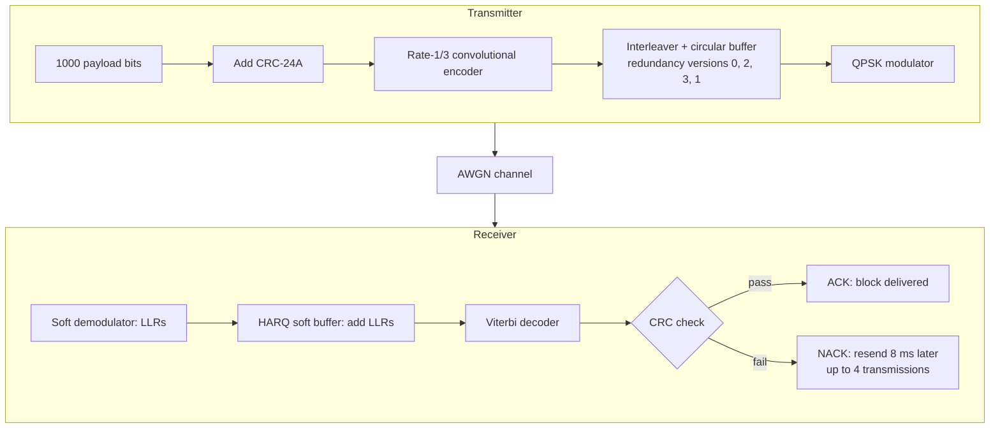
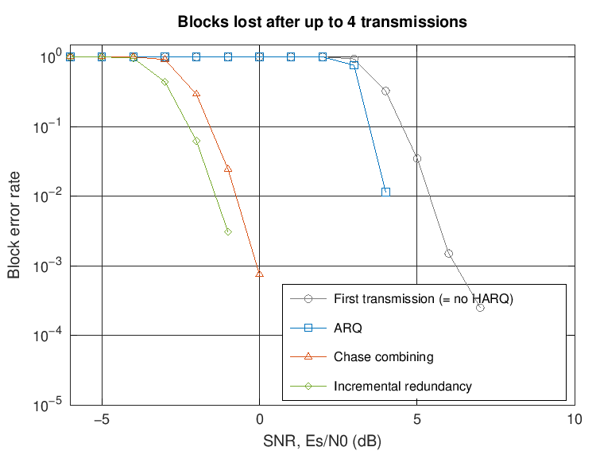
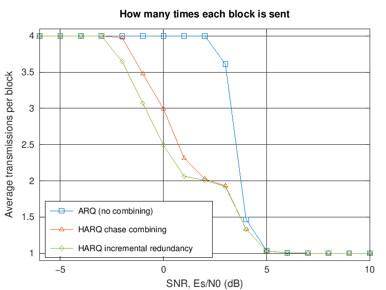
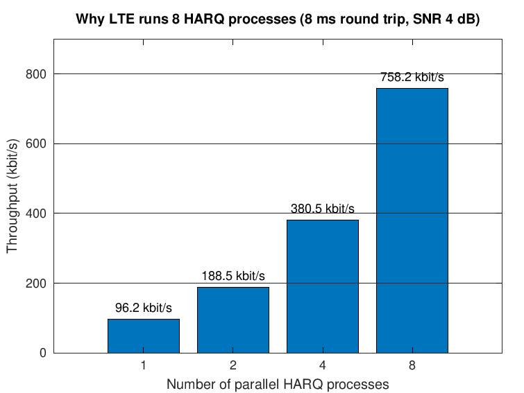
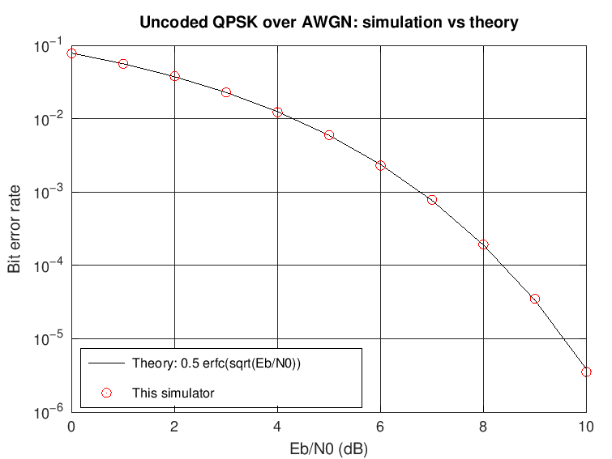

# LTE HARQ Link Simulator

A C++ simulator that shows how a 4G (LTE) link recovers data lost over a noisy radio channel.

When a block of data arrives with errors, LTE doesn't simply throw it away. The receiver keeps what it got, asks for a retransmission and combines the copies. This is called **HARQ** (Hybrid Automatic Repeat reQuest). The simulator builds the main pieces of an LTE transmitter and receiver from scratch in C++17, with no external libraries, and measures how much HARQ helps.

It compares four ways of handling a failed block:

- **No HARQ:** the block is lost.
- **ARQ:** the block is sent again and the failed copy is thrown away.
- **Chase combining (CC):** the same coded bits are sent again, and the receiver adds up the soft information (LLRs) from every copy.
- **Incremental redundancy (IR):** each retransmission sends different coded bits (a new redundancy version), so the code gets stronger with every copy.

## What's inside



- **CRC-24A** to detect errors, generator 0x864CFB (3GPP TS 36.212, section 5.1.1)
- **Rate-1/3 convolutional encoder** with constraint length 7 and LTE's generator polynomials 133/171/165 octal (TS 36.212, 5.1.3.1)
- **Soft-decision Viterbi decoder** with 64 states
- **Rate matching:** LTE's 32-column sub-block interleaver, a circular buffer and redundancy versions in the order 0, 2, 3, 1 (TS 36.212, 5.1.4.2)
- **QPSK** with LTE's bit mapping (TS 36.211, 7.1.2); the demodulator outputs LLRs
- **AWGN channel**
- **8 parallel stop-and-wait HARQ processes** with an 8 ms round trip and up to 4 transmissions per block (TS 36.321)

Each block carries 1000 data bits plus a 24-bit CRC and goes out as 1536 coded bits (768 QPSK symbols), so the first transmission has code rate 2/3. With one block per 1 ms subframe, the top speed is **1000 kbit/s**.

## Results

`make results` runs every experiment, 4000 subframes per point. `scripts/plot_results.m` draws the graphs.


| SNR, Es/N0 (dB) | No HARQ | ARQ | Chase combining | Incremental redundancy |
|---:|---:|---:|---:|---:|
| −3 | 0.0 | 0.0 | 21.2 | 140.5 |
| −2 | 0.0 | 0.0 | 178.0 | 256.5 |
| −1 | 0.0 | 0.0 | 280.0 | 324.2 |
| 0 | 0.0 | 0.0 | 333.2 | 400.5 |
| 2 | 0.0 | 0.2 | 492.8 | 498.0 |
| 4 | 676.5 | 672.5 | 751.8 | 751.8 |
| 6 | 998.5 | 996.8 | 996.8 | 996.8 |

*Throughput in kbit/s.*

What this shows:

1. **Combining is what makes HARQ work.** ARQ on its own delivers no more data than no HARQ at all, because every resend is a fresh attempt that uses up a subframe. With combining, the link keeps delivering data at SNRs 6–7 dB lower than without HARQ.
2. **Incremental redundancy wins when the signal is weak.** At −2 dB it delivers 256.5 kbit/s against 178.0 kbit/s for chase combining, 44% more. Its second transmission sends the coded bits the first one left out, so together they form the full rate-1/3 code. Chase combining only repeats the same rate-2/3 bits.
3. **Incremental redundancy also loses fewer blocks.** At −1 dB it loses 0.3% of blocks after 4 tries, against 2.4% for chase combining.





### Why LTE uses 8 HARQ processes

With a single process, the transmitter sends a block and then waits 8 ms for the answer, so the link sits idle 7 subframes out of 8. Eight processes take turns and keep every subframe busy:

| Processes | Throughput at 4 dB (IR) | Subframes used |
|---:|---:|---:|
| 1 | 96.2 kbit/s | 12.5% |
| 2 | 188.5 kbit/s | 25% |
| 4 | 380.5 kbit/s | 50% |
| 8 | 758.2 kbit/s | 100% |



### Checking the simulator

- The bit error rate of uncoded QPSK matches the textbook formula 0.5·erfc(√(Eb/N0)) from 0 to 10 dB (`harq_sim --validate`).
- No block ever passed the CRC with wrong data.
- 67 unit-test checks cover the CRC, the encoder and decoder, rate matching, QPSK, the HARQ state machine and the full link.



## Build and run

You need a C++17 compiler (g++ or clang++) and `make`. Tested on Linux with g++ 13 and clang 18.

```bash
make            # build bin/harq_sim and bin/run_tests
make test       # run the unit tests
make results    # run every experiment and write results/*.csv (takes a few minutes)
```

Draw the graphs in MATLAB with `run('scripts/plot_results.m')`, or in GNU Octave with `octave-cli scripts/plot_results.m`.

Some single runs:

```bash
./bin/harq_sim --scheme ir --snr-start -4 --snr-stop 6 --subframes 8000
./bin/harq_sim --process-sweep --snr 2 --scheme cc
./bin/harq_sim --validate
./bin/harq_sim --help
```

The SNR sweep uses every CPU core: worker threads pick up SNR points from a shared atomic counter. Each point's random seed depends only on its SNR, so you get the same numbers whatever the number of threads.

## Simplifications

This is a learning model, not a complete LTE implementation:

- **Convolutional code instead of turbo code.** LTE's data channels use a turbo code. This simulator uses LTE's rate-1/3 convolutional code (from the control channels) with a Viterbi decoder, which is much simpler to build and still shows how HARQ combining works.
- **Zero-tail instead of tail-biting**, so the decoder always starts and ends in state 0.
- **Simplified redundancy version positions:** each one starts a quarter of the circular buffer after the previous one.
- **Ideal conditions:** white noise only (no fading), a single user, ACK/NACK messages that never get lost, and a fixed modulation and code rate.
- **Latency** is measured from a block's first transmission to its successful decode, without processing delays.

## Files

```
include/, src/
  crc24a          CRC-24A attach and check
  conv_code       rate-1/3 convolutional encoder and soft-decision Viterbi decoder
  rate_matcher    sub-block interleaver, circular buffer, redundancy versions, LLR combining
  modem           QPSK modulator, LLR demodulator, AWGN channel
  harq_process    one stop-and-wait HARQ process (transmit side and soft buffer)
  simulator       the link: 8 processes, subframe loop, statistics
  main.cpp        command-line tool: SNR sweep, process sweep, validation, multithreading
tests/            unit tests (make test)
scripts/          plot_results.m for MATLAB or Octave
results/          CSV output of make results
docs/             graphs and HOW_IT_WORKS.md, a walkthrough of every block
```

## References

- 3GPP TS 36.211: physical channels and modulation (QPSK mapping)
- 3GPP TS 36.212: multiplexing and channel coding (CRC, convolutional code, rate matching)
- 3GPP TS 36.321: medium access control (HARQ)
- MathWorks LTE Toolbox example "DL-SCH HARQ Modeling", for comparison with a reference HARQ model

## License

MIT. See [LICENSE](LICENSE).
